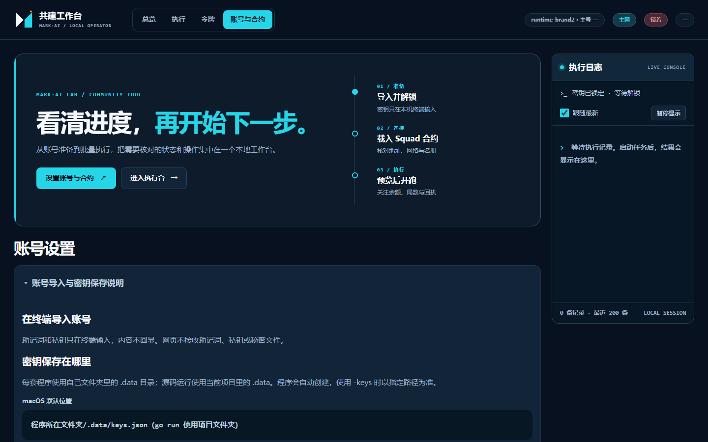
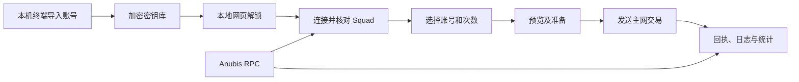

# MARK·AI 共建工作台

**把多账号共建的链上状态、准备步骤和批量执行收进一个本地工作台。**

[MARK·AI 社区](https://markai.club/) · [产品介绍与安装](https://markai.club/apps/funbot-workbench) · [下载 Windows 版](https://github.com/mark-believe/funbot-workbench/releases/latest) · [问题反馈](https://github.com/mark-believe/funbot-workbench/issues)



> 截图是空数据环境。真实账号、余额和战绩须由使用者在本机配置后读取；仓库不附带私钥、助记词或个人账本。

## 用途与能力

共建工作台是 MARK·AI 社区孵化的开源本地工具，面向需要管理大量 Anubis 链账号的操作者。它把「先看状态、再选账号、预览准备、执行和核对回执」放在同一条工作流中。

| 工作区 | 能做什么 |
| --- | --- |
| 总览 | 账号、余额、比赛进度、盟主、令牌、福泽分布与近期战绩；搜索和分组查看。 |
| 执行 | 选择账号及次数、检查状态、批量参赛、领取与归集、补币与收回 Gas。 |
| 令牌 | 检查主号福泽、令牌铸造与归集；专属固定清单在脱敏源码中未配置。 |
| 账号与合约 | 本地密钥库解锁、Squad 合约连接、派生钱包、委托、名册与拜师授权。 |
| 独立辅助 | 只读福泽模拟、分组回本与扩组核算脚本；需要自行提供名册、账本和计划任务。 |

默认连接 **Anubis 主网（chain ID 6714）**。导入真实钱包并解锁后，交易操作会使用真实资产并产生 Gas 费用。软件不保证收益。

## 优先：交给 Codex、Kimi 等智能体安装

将下面整段复制给能操作本机的智能体。它会按你的系统完成下载、校验、启动与验证；**私钥和助记词仍由你本人在本机终端输入**。

> 请帮我安装 MARK·AI 共建工作台：https://github.com/mark-believe/funbot-workbench 。先阅读 README、LICENSE、最新 Release 与 SHA256SUMS.txt。Windows 优先下载最新 Release 的 Windows x64 ZIP，校验 SHA-256 后解压到独立目录；其他系统从源码用 Go 1.26.8 或更新版本构建。创建全新的私有数据目录，启动时用 `-keys` 指向该目录的 `keys.json`，只监听 `127.0.0.1`。打开程序打印的完整本地访问链接，验证页面和只读状态 API，并告诉我程序位置、数据位置、如何重启与停止。不要读取、导入或复制我现有的助记词、私钥和 `.data`；不要替我签名或发起链上交易。若需要本人输入密码或密钥，停在对应的本机终端步骤让我操作。

这是一段安装任务说明，不是把密钥交给智能体的授权。智能体应报告已完成的步骤和实际验证结果。

## 手动安装

### Windows 下载版

1. 从 [Releases](https://github.com/mark-believe/funbot-workbench/releases/latest) 下载 `MARKAI-Funbot-Workbench-Windows-x64.zip` 和 `SHA256SUMS.txt`。
2. 在 PowerShell 运行 `Get-FileHash -Algorithm SHA256 .\MARKAI-Funbot-Workbench-Windows-x64.zip`，与校验文件核对。
3. 解压到独立文件夹，在该文件夹打开 PowerShell，运行 `.\workbench.exe`。程序默认只监听 `127.0.0.1:8910`，占用时自动尝试后续端口；会打开本地网页，或在终端打印完整访问链接。
4. 在另一个 PowerShell 窗口运行 `.\workbench.exe -add master` 导入主号，随后用 `-add member` 或 `-add derive` 导入队员。首次导入时设置密钥文件密码，完成后回到网页解锁。

建议用 `-keys` 指定**安装目录和 Git 仓库之外**的专用路径；同一组账号后续启动与导入都使用同一 `-keys` 路径。程序内「账号与合约」有逐步命令说明。

### 从源码构建（Windows、macOS、Linux）

需要 Go 1.26.8 或更新版本：

```text
go test ./...
go build -trimpath -buildvcs=false -o workbench .
./workbench -no-open
```

Windows 可把输出改成 `workbench.exe`。独立辅助脚本分别需要 Python + openpyxl、Node.js + `@oai/artifact-tool`；主程序不依赖它们。

维护者可用 `scripts/package-windows.ps1` 构建 Windows 发行 ZIP 和 SHA-256 校验文件；脚本只打包明确列出的程序、文档与辅助源码，不打包本机数据目录。

## 工作流程



Go 服务和网页都在本机运行，默认只监听回环地址。网页通过会话访问令牌调用本机 API；助记词和私钥只通过终端输入，保存在本机加密密钥文件中。详见 [部署说明](DEPLOYMENT.md)。

## 安全边界

- 核对 Release 校验和；不要运行来源不明的改包。
- 导入真实钱包前，先在空数据目录熟悉页面。不要把助记词或私钥发给网页、聊天窗口或他人。
- 部署、委托、授权、打局、转账和归集都会影响主网资产。每次核对网络、主号、合约、目标地址、选中账号和 Gas。
- `.gitignore` 排除常见本地数据文件；提交代码前仍需检查暂存区。历史账本、分组名册、任务计划和专属清单未包含在公开源码中。
- 公开源码与可复核的发行包**不等于完成第三方安全审计**。发现风险请在 [Issues](https://github.com/mark-believe/funbot-workbench/issues) 提交不含密钥的复现信息。

## 开源与持续维护

本项目基于 [fun-tool/funbot](https://github.com/fun-tool/funbot) 的 MIT 开源代码继续开发，保留原仓库的版权声明与许可文本。MARK·AI 版本新增操作者界面、统计与部署文档；具体变更以 Git 历史为准。

代码采用 [MIT License](LICENSE)。MARK·AI 名称与品牌图形归其权利人所有，不因代码许可而授予商标使用权。欢迎提交可复现的问题、界面建议、文档修正与 Pull Request。

我会持续维护和升级这套工作台：优先改善首次安装与账号准备、操作者状态视图、主网交易前的明确核对，以及跨平台安装体验。具体改动与发布记录会公开留在 [Issues](https://github.com/mark-believe/funbot-workbench/issues) 和 [Releases](https://github.com/mark-believe/funbot-workbench/releases)。这是一项持续迭代承诺，不表示固定发布日期或收益承诺。

想继续看 MARK·AI 的实战工具与社区项目，可 [关注 GitHub 账号](https://github.com/mark-believe)、访问 [MARK·AI 社区应用](https://markai.club/apps/)；合作或加入社区可从 [官网右下角联系 Mark](https://markai.club/) 获取本人微信和 DeBox 联系入口。
